<p align="center">
  
</p>

<h1 align="center">OpenChatMix</h1>

<p align="center">
  Lightweight ChatMix for any headset on Windows: balance game and chat, process your microphone,
  and drive the ChatMix dial of SteelSeries Arctis headsets without SteelSeries GG or Sonar.
</p>

<p align="center">
  <a href="https://swiftlyx.github.io/OpenChatMix/">Website</a> · English · <a href="README.uk.md">Українська</a>
</p>

<p align="center">
  OpenChatMix is free and open source. If you'd like to say thanks, you can support it on
  <a href="https://ko-fi.com/swiftlyx">Ko-fi</a> or through a <a href="https://send.monobank.ua/jar/8C2ACvGoty">monobank jar</a>. Entirely optional:
  bug reports and headset tests help just as much.
</p>

---

ChatMix balances game audio against voice chat with one control: turn it one way and the game gets
louder while chat gets quieter, turn it the other way and chat takes over. OpenChatMix brings that to
any headset or speakers on Windows, with hotkeys, the mouse wheel or the panel, and adds a microphone
chain with noise suppression, a compressor, an equalizer and VST plugins.

On SteelSeries Arctis headsets it goes further. Their hardware ChatMix dial normally only works while
SteelSeries GG and Sonar run: several background processes, hundreds of megabytes of RAM and a set of
virtual audio devices. OpenChatMix talks to the headset directly over USB HID instead, and also
covers its native settings.

The balance is applied as per-app volume in Windows, so the sound keeps going straight to the
headset. If you prefer Sonar's way, an optional [virtual device mode](#virtual-device-mode) mixes Game
and Chat from two virtual audio cables instead. It is a single native executable that idles at 0% CPU
and installs no drivers of its own.

On its own OpenChatMix needs about 4 MB of memory. What you add on top costs its own: the microphone
chain and the equalizers a little, VST plugins as much as they need — a plugin with a neural network,
such as a voice cleaner, can take hundreds of megabytes.

<p align="center">
  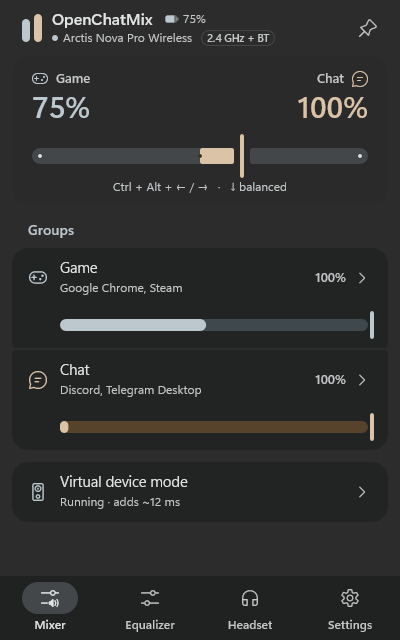
  &nbsp;
  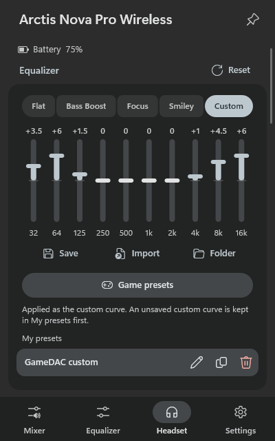
  &nbsp;
  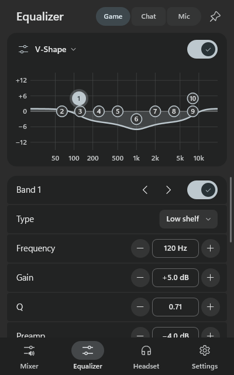
</p>

## Works with any headset

Any headset, speakers or an unsupported SteelSeries model:

- The balance is set in the panel, with hotkeys or with the mouse wheel while a key combination is
  held, and applies to the default output device, whose name the panel shows. A single key works as
  a hotkey, so a keyboard's volume knob can act as a ChatMix wheel.
- Game, Chat and Media groups, ducking, app profiles and the popup work the same way.
- The [microphone chain](#microphone) and, in virtual device mode, the equalizer work with any device.

## SteelSeries Arctis: one app instead of SteelSeries GG

SteelSeries headsets from the [list below](#supported-headsets) also get the hardware dial and their
native settings, so GG and Sonar can stay closed:

- **ChatMix** from the dial on the GameDAC, base station or headset.
- **Native headset settings** from GG's Engine page: the Engine EQ with its presets and custom
  curve, microphone volume, sidetone, mic mute LED, gain, volume limiter, display brightness and
  dimming, auto power-off, wireless and Bluetooth options and battery level, depending on the model.
  They are stored in the headset itself and stay active while no app runs.
- **Battery** beside the app's name on the *Mixer* tab, in the tray tooltip, as the tray icon at the
  even balance (in the theme's color, or green to red by its charge) and as a popup when it runs low.
  Bluetooth headphones show theirs too when Windows gets the level from them.
- **Only what your model has.** The panel shows the settings, the battery and the display options
  that the connected model supports, and nothing it does not.
- **A Sonar-style mode** with two virtual audio devices and a 10-band parametric equalizer, if you
  want it.

## Features

- **Hardware dial.** The GameDAC / base station dial drives the Game–Chat balance. While
  OpenChatMix runs, the ChatMix icon is shown on the GameDAC display, so a glance tells you it is active.
- **Volume stays hardware.** Only ChatMix reports are used; turning the knob in volume mode keeps
  working as before, and a popup shows the volume as you turn it. The panel shows which mode the dial
  is in.
- **Your own volumes stay.** ChatMix does not move the app sliders of the Windows volume mixer, so a
  volume you set for an app yourself keeps working on top of the balance. In virtual device mode the
  taskbar slider and the volume keys work too, while recordings of the Game and Chat devices (for
  example in OBS) keep the full level.
- **Game / Chat / Media groups.** Unknown apps follow the Game side, Discord and the Xbox party chat
  start in Chat (they appear in the group once installed), and Media apps (music, videos) are never
  touched by ChatMix — like Sonar's Media channel. The Media group is off until you turn it on in
  *Settings → Audio*.
- **A device per group, no virtual cables needed.** *Settings → Audio → Audio routing* lets each group
  play on its own device, for example Game and Chat on the headset and Media on the speakers. Windows
  sends the group's apps there (its per-app device, which OpenChatMix clears again when it exits), and
  ChatMix still balances Game and Chat wherever they play.
- **Manual assignment.** Open a group and add any running app, or browse for an `.exe`, even if it
  is closed.
- **Native headset settings**, shown only for the connected model: the 10-band Engine EQ with the
  SteelSeries presets (Flat, Bass Boost, Focus, Smiley) and a custom curve, microphone volume,
  sidetone, mic mute LED, gain, volume limiter, GameDAC brightness and screen dimming, the line out
  (speakers, or a stream mix of the main sound, the aux input and the microphone), noise control (off,
  transparency or ANC), auto power-off, 2.4 GHz mode, Bluetooth options and the battery levels, the base
  station's spare battery included, depending on the headset.
- **Game presets on the headset itself.** Any game preset (built-in or from Sonar) can be put on the
  headset's own Engine EQ, converted to its ten bands, so it works without virtual devices too.
- **EQ presets as files.** Save the current curve, import presets from others, keep backups.
- **Screensaver for the GameDAC display** (Nova Pro). While no sound plays, an animation, a clock
  or your own image or GIF keeps the OLED from burning in. Any sound brings the usual screen back.
  The *Screensaver on/off* hotkey keeps it on until you press it again, and *Test* on
  the *Headset* tab shows it for a few seconds. It also runs while SteelSeries GG is open and gives
  way to GG's own apps for the display (Discord, Now Playing, Spotify, Audio Visualizer) that are
  switched on: the moment one of them hands GG a message, a track or its animation, even without sound,
  the screensaver stops drawing over it until GG is done. With the Nova Pro Wireless it can show a
  Bluetooth icon in a corner while the base station's Bluetooth is on: steady with a device connected,
  blinking slowly while it waits for one and fast while it pairs.
- **Visualizer for the GameDAC screen** (Nova Pro). Bars that follow the sound fill the whole screen while
  music or a video plays, or for any sound if you like. Music and video are told apart the way Windows
  knows them: an app that plays tells the media controls of Windows, as players and YouTube in the
  browser do. Turning the knob shows the usual screen for a moment.
- **3rd party add-ons for the GameDAC screen** (Nova Pro). Programs made for SteelSeries GameSense can
  show messages and more on the GameDAC while SteelSeries GG is closed. OpenChatMix includes no such
  programs: you add one you already have by choosing its file, and OpenChatMix starts it and shows what
  it sends. With a program for Discord, such as the one that comes with GG (`gamesense-discord-x64.exe`
  in GG's folder; OpenChatMix knows one by "discord" in its file name), every event gets its own screen,
  as in GG's Engine: displays with an icon, a heading and the message, the name of who is talking or the
  channel, or an image, shown once, a number of times or while the event lasts.

<p align="center">
  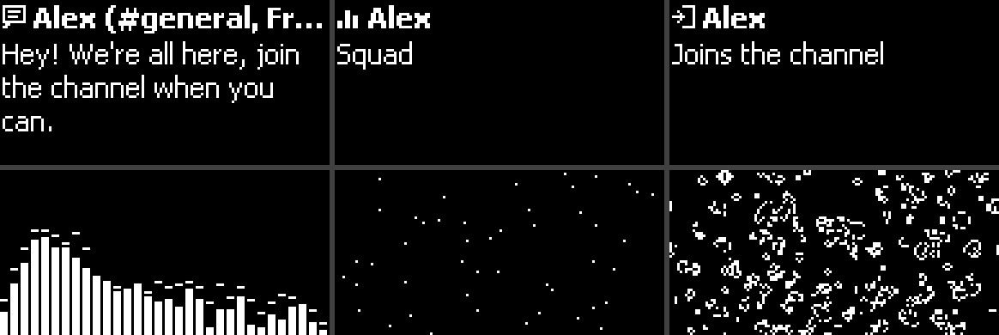
</p>

<p align="center">
  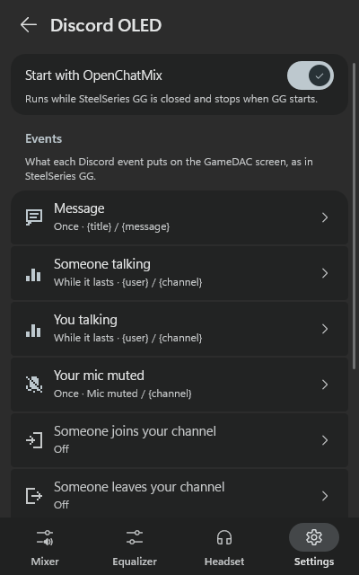
  &nbsp;
  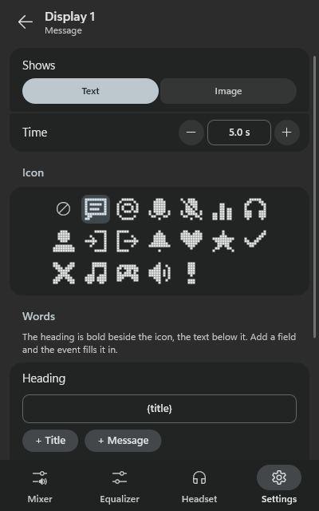
</p>

- **Virtual device mode (optional).** Instead of changing app volumes, mix Game and Chat from two
  virtual audio cables into the headset, like Sonar does. Chat apps are sent to the Chat cable and
  all other apps to the Game cable on their own. The cables are switched on and made the Windows
  defaults only while the mode runs.
- **Microphone chain (optional).** Noise suppression, a compressor, a 10-band equalizer and your own
  VST 2 and VST 3 plugins on the microphone, played into a virtual cable that Discord, OBS or a game
  use as their microphone — like LightHost, with the effects built in. Microphone and cable levels can
  be held at 100%. See [Microphone](#microphone).
- **Equalizer for any headset** (virtual device mode, optional). A 10-band parametric EQ for Game
  and for Chat with a response graph like Sonar's, Bass Boost, Voice Clarity, Treble Boost and Smart
  Volume, built-in presets, your own preset files and the presets of a local SteelSeries GG
  installation (Sonar's and Engine's). Each channel can also run your own VST 2 and VST 3 plugins, such as a convolver with
  impulse responses, crossfeed or a loudness plugin, and DeepFilterNet on Chat removes noise from the
  voices of others. It is off until you turn it on in *Settings → Audio*.
- **Hotkeys with an on-screen popup** (`Ctrl + Alt + ← / → / ↓` by default), plus optional hotkeys
  to mute game, chat or media, to send the sound to the next output device or feed the microphone chain
  from the next microphone (virtual cables are skipped), and one that turns the GameDAC screensaver on
  and off. A single key works as well, so a keyboard's volume knob can become a ChatMix wheel. Hotkeys
  also work without a SteelSeries headset: the balance is then applied to the default output device.
- **Output devices.** Put the connected devices in your order of preference; optionally the sound
  moves to the next one when the output disconnects and back when the preferred device reconnects.
  The *Next output device* hotkey follows the same order. Disconnected and disabled devices and
  virtual cables are not listed. Devices you never want to switch to go into *Never switch to*.
- **Mouse wheel ChatMix (optional).** Hold `Ctrl + Win`, `Alt + Win` or `Ctrl + Alt + Shift` and
  turn the wheel: up for more chat, down for more game; click the wheel for an even balance. Only
  that exact combination is taken, so zooming with `Ctrl` or `Ctrl + Alt` and the wheel keeps working.
- **Exact balance without a ChatMix headset.** With a headset dial the balance keeps to its 12 steps
  per side, so the app and the GameDAC always agree. Without one, the slider and the arrow keys move
  it by single percents; the mouse wheel and the hotkeys by 10%.
- **Optional extras**, each with its own switch: lower the game while someone talks in chat
  (ducking), app profiles that set the balance and the Game, Chat, Media and headset equalizers while
  an app or a game runs, popups for the ChatMix wheel and for the knob of a GameDAC or base station
  (the balance, or the volume in volume mode) in the screen corner you choose, a popup when noise
  control is switched with the headset's button (on the Nova Pro Wireless also on the base station
  screen), and a low battery popup for wireless headsets (at 15% by default).
- **Material 3 tray panel** with an automatic, light or dark theme in soft, pastel colors: the
  Windows accent (the default), eight presets or any color for Game, and a color of its own for Chat
  that always stays easy to tell apart from Game. Standard, medium or high contrast, and an Acrylic, Mica or
  solid background. The whole panel works from the keyboard. Animations run at the monitor's refresh
  rate, including 144 Hz and 240 Hz screens, and can be reduced. The tray icon shows Game and Chat
  as two bars that shrink with their level; it can be colored or monochrome, and at the even balance
  the bars can morph into a square, a ring, an equals sign or, with a wireless headset, its battery
  lying on its side as in Material 3 Expressive, in the theme's color or from green to red by its
  charge, and back.
- **Material 3 at the tray icon too**: hovering it shows a card with the device, its battery and the
  balance, and right-clicking opens a Material 3 menu that works with the keyboard as well. Icon
  buttons in the panel explain themselves in tooltips.
- **How the headset is connected** at a glance: the *Mixer* tab shows it beside the headset's name
  (USB, 2.4 GHz, Bluetooth, 3.5 mm, HDMI or S/PDIF).
- **Export and import of all settings** in one ZIP file, to move them to another PC or keep a copy.
  An import keeps the previous settings as a backup first.
- **English and Ukrainian** interface.
- **A short tour** on the first start shows what is where; *Settings → General → Show the tour*
  opens it again.
- Starts with Windows, reconnects after sleep, unplugging or SteelSeries GG releasing the headset.
- Warns once (and in the panel) if SteelSeries GG starts while a SteelSeries headset is connected;
  the warning can be hidden or turned off, and never appears for other headsets.
- **Updates from GitHub** (optional): once a day OpenChatMix asks the project's GitHub releases for
  a newer version. *Install* downloads it, checks it against the release's `SHA256SUMS.txt` and
  restarts. Turn the check off in *Settings → Updates*.
- No telemetry. The update check is the only network access.

<p align="center">
  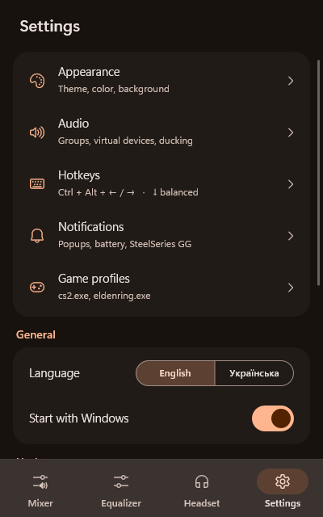
  &nbsp;
  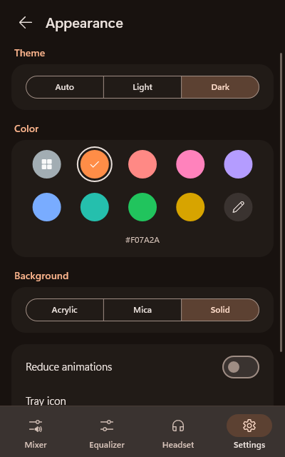
  &nbsp;
  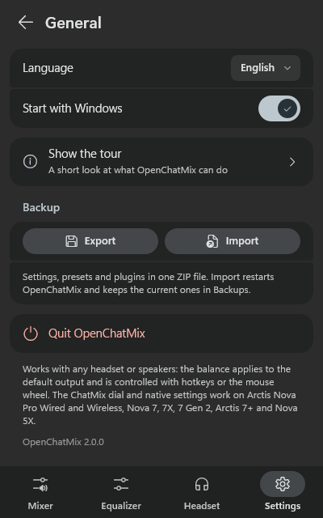
</p>

<p align="center">
  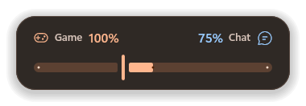
  &nbsp;
  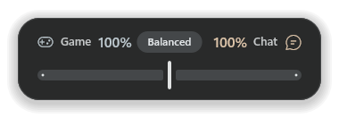
</p>

## Supported headsets

The hardware ChatMix dial and the native settings are available on these models; everything else
works with any headset.

| Headset | USB product IDs | Status |
| --- | --- | --- |
| Arctis Nova Pro Wired (PC, Xbox) | `12CB`, `12CD` | ✅ Tested |
| Arctis 7+ / 7P+ / 7X+ / 7+ Destiny | `220E`, `2212`, `2216`, `2236` | ✅ Tested (Arctis 7+) |
| Arctis Nova Pro Wireless (PC, Xbox) | `12E0`, `12E5` | ✅ Works, reported by [@Katan21](https://github.com/Katan21) in [#5](https://github.com/Swiftlyx/OpenChatMix/issues/5) |
| Arctis Nova 7 / 7 Gen 2 | `2202`, `22A1`, `227E` | ✅ Works, reported by [@zer0ed](https://github.com/zer0ed): Nova 7 `22A1` ([#1](https://github.com/Swiftlyx/OpenChatMix/issues/1)), Nova 7 Gen 2 `227E` ([#2](https://github.com/Swiftlyx/OpenChatMix/issues/2)); the Gen 2 protocol equalizer works on `22A1` and `227E` ([#7](https://github.com/Swiftlyx/OpenChatMix/issues/7)) |
| Arctis Nova 7X / Diablo IV / WoW | `2206`, `2258`, `229E`, `22AD`, `22A4`, `22A5`, `223A`, `22A9`, `227A`, `22AB` | Untested — same protocol as Nova 7; `229E`, `22A5`, `22AD`, `22A9` and `22AB` use the Gen 2 protocol with the experimental equalizer |
| Arctis Nova 5X | `2253`, `2264` | Untested — Game and Chat may be swapped |
| Arctis Nova Elite | `2244`, `2270` | ✅ ChatMix dial, battery, settings and output switching work, reported by [@liquidshadowfoxx](https://github.com/liquidshadowfoxx) in [#6](https://github.com/Swiftlyx/OpenChatMix/issues/6); its own equalizer is experimental, from [@Lasfecas](https://github.com/Lasfecas)'s capture in [#6](https://github.com/Swiftlyx/OpenChatMix/issues/6) |

Not supported: the **Arctis Nova 7P** (its dial controls sidetone, not ChatMix). The original
**Arctis 7, 9 and Pro Wireless** mix game and chat in hardware through two playback devices and do
not need an app.

Reports for other models are very welcome — see [Troubleshooting](#troubleshooting) for how to
collect a log.

## Getting started

1. Download `OpenChatMix.exe` (or the zip) from the [Releases](../../releases) page.
2. Quit SteelSeries GG completely (tray icon → Exit) and disable it in
   *Task Manager → Startup apps*. GG and OpenChatMix cannot control the headset at the same time.
3. In *Settings → System → Sound*, choose the headset itself (for example
   *Headphones (Arctis Nova Pro)*) as the output device instead of *SteelSeries Sonar – Gaming*.
   In Discord and other apps, set the output to *Default* or to the headset. Prefer Sonar's setup
   with separate Game and Chat devices? See the [virtual device mode guide](#virtual-device-mode)
   further down.
4. Run `OpenChatMix.exe`. A tray icon with two bars (Game and Chat) appears; click it to open the panel.

The executable is not code-signed, so Windows SmartScreen may ask for confirmation on the first run
(*More info → Run anyway*).

**Antivirus warnings.** Some antivirus programs distrust new, unsigned executables, especially ones
that talk to USB devices, start with Windows and can replace themselves when an update is
installed. A warning about OpenChatMix is a false positive. To be sure you have the genuine file,
compare `Get-FileHash OpenChatMix.exe` with `SHA256SUMS.txt` from the same release, read the source
code in this repository, or [build it yourself](#building-from-source). Please report false
positives to your antivirus vendor; for Microsoft Defender use the
[file submission page](https://www.microsoft.com/wdsi/filesubmission).

## Quick guide

- **Balance game and chat.** On an Arctis with a ChatMix dial, turn it (on the GameDAC, press the knob
  first to switch it to ChatMix). With any other headset or speakers use `Ctrl + Alt + ←` / `→`
  (`↓` centers), the slider on the *Mixer* tab, or the mouse wheel with a key combination
  (*Settings → Hotkeys → Mouse wheel*).
- **Tell it which apps are chat.** *Mixer → Groups → Chat → Add*, then pick Discord, Telegram or any
  other app. Everything else follows Game. Music and videos that should never change go into *Media* (turn
  the group on in *Settings → Audio*).
  The trash icon next to an app takes it out of its group again.
- **Set each side's volume.** The sliders under *Game* and *Chat* on the *Mixer* tab. Windows volumes
  stay at 100%.
- **Headset settings (Arctis).** The *Headset* tab: equalizer presets and your own curve, microphone,
  sidetone, gain, display and screensaver. They are stored in the headset itself.
- **Mix like Sonar, with an equalizer (optional).** Install two virtual cables and turn on *Settings →
  Audio → Virtual device mode* and *Equalizer*; see [Virtual device mode](#virtual-device-mode).
- **Clean up your microphone (optional).** Install VB-CABLE, turn on *Settings → Microphone → Process
  the microphone* and choose *CABLE Output* as the microphone in Discord; see [Microphone](#microphone).
- **Make it look your way.** *Settings → Appearance*: theme, contrast, Game and Chat colors, the
  battery's color, background and the tray icon.

## Usage

| Action | How |
| --- | --- |
| Change the balance | GameDAC: press the knob to switch it to ChatMix, then turn it. Other headsets: turn the ChatMix wheel. |
| | *Mixer* tab: drag the slider, scroll over it, or use ← / →. Double-click centers it. |
| | Hotkeys: `Ctrl + Alt + ←` more game, `Ctrl + Alt + →` more chat, `Ctrl + Alt + ↓` balanced. |
| | Mouse wheel with the key combination held, once turned on in *Settings* → *Hotkeys* → *Mouse wheel*. |
| Volume of Game or Chat | *Mixer* → the slider under *Game* or *Chat*. Its darker fill shows what plays; Windows volumes stay at 100%. |
| Move an app between groups | *Mixer* → *Groups* → open a group → *Game / Chat / Media* next to the app. |
| Add an app manually | Open a group → *Add* → pick a running app or *Browse .exe*. |
| Remove an app from a group | Open the group → the trash icon next to the app. It follows Game again; a closed app leaves the list. |
| Theme, contrast, Game and Chat colors, battery color, background, tray icon | *Settings* → *Appearance*. |
| Use the panel from the keyboard | `Tab` / `Shift + Tab` move between controls, `Enter` (or `Space`) presses, the arrows change sliders and values, `Esc` goes back. |
| Hotkeys, popups and their corner, battery warning | *Settings* → *Hotkeys* / *Notifications*. |
| Write a log for a bug report | *Settings* → *General* → *Diagnostics* → *Write a log*; *Open the log folder* shows `OpenChatMix.log`. |
| Language, startup, the tour | *Settings* → *General*. |
| Back up the settings or move them to another PC | *Settings* → *General* → *Export*; *Import* there takes them back and restarts OpenChatMix. The previous settings go to `%APPDATA%\OpenChatMix\Backups` first. |
| Recover the headset | Tray menu → *Reconnect headset*. |
| Headset settings and EQ | *Headset* tab (shown when a supported headset is connected). |
| Rename, copy or delete saved headset presets | *Headset* tab → the buttons beside each preset under *My presets*. Deleted presets go to the Recycle Bin. |
| Save, import or back up EQ presets | *Headset* tab → *Save* / *Import* / *Folder*. Presets live in `%APPDATA%\OpenChatMix\Presets`. |
| Screensaver on the GameDAC | *Headset* tab → *Screensaver* → pick an animation and the delay; the *Screensaver on/off* hotkey keeps it on until pressed again. |
| Line out: speakers or a stream mix | *Headset* tab → *Line out* (GameDAC); in *Streaming* set the main sound, aux input and microphone levels. |
| Virtual device mode, Media group, equalizer, ducking | *Settings* → *Audio*. |
| Equalizer for Game and Chat | *Equalizer* tab (virtual device mode), once turned on in *Settings* → *Audio*. |
| Microphone processing and VST plugins | *Settings* → *Microphone*; its equalizer is the *Mic* channel of the *Equalizer* tab. |
| VST plugins on Game, Chat or Media | *Equalizer* tab (virtual device mode) → the channel → *Plugins*. |
| Order of output devices, switching on disconnect | *Settings* → *Output devices*; drag a device to its place. |
| Never switch to a device | *Settings* → *Output devices* → the ⦸ button next to it; ↶ under *Never switch to* brings it back. |
| Reorder the microphone effects or plugins | *Settings* → *Microphone* → drag a step or a plugin by its handle. |
| Type an exact value | Click the value between − and + (EQ frequency, level, Q, preamp, ducking, battery warning), type it (`1.5k` works for 1500 Hz) and press Enter. |
| Keep the panel open | Pin it with the pin next to the page title; click it again to let the panel hide when it loses focus. |
| Next output device | *Settings* → *Hotkeys* → *Next output device*. |
| Next microphone for the virtual microphone | *Settings* → *Hotkeys* → *Next microphone* (shown while *Settings* → *Microphone* processes it). |
| App profiles (balance and equalizers per app) | *Settings* → *App profiles* → *Add*. |
| Visualizer on the GameDAC screen | *Headset* → *Visualizer* → *Show while something plays*. |
| 3rd party add-ons for the GameDAC screen | Close SteelSeries GG, then *Settings* → *3rd party add-ons* → *Add* and pick the program, e.g. `C:\Program Files\SteelSeries\GG\apps\engine\engineApps\discord\gamesense-discord-x64.exe`. |

When OpenChatMix exits, every app it lowered plays at its own volume again and the GameDAC dial
returns to plain volume control. An app that exits while ChatMix lowers it also starts at its own
volume next time.

Headset settings are only sent when you change them in the panel; OpenChatMix never overwrites the
headset's settings on its own. On the Nova Pro Wired the current EQ preset and curve, microphone
volume, sidetone, gain and ChatMix balance are read from the GameDAC when it connects and after every
change; display brightness and screen dimming are not reported by the device, so the panel shows the
values last set from OpenChatMix.

When a preset stored on the headset (Flat, Bass Boost, Focus, Smiley) is active, the Headset tab shows
its curve; choose *Custom* to edit the bands. *Game presets* puts a game preset on the headset as the
custom curve. If the current custom curve is not saved yet, it is first kept under *My presets*.

### Virtual device mode

1. Install two virtual audio cables. Any virtual audio cables work; this free setup is tested with
   OpenChatMix:

   | Role | Cable | License |
   | --- | --- | --- |
   | Game | [VB-Audio Hi-Fi Cable](https://vb-audio.com/Cable/) | free for end users |
   | Chat | [Virtual Audio Cable Lite](https://vac.muzychenko.net/en/download.htm) | free for home use; one cable, 48 kHz / 16-bit |
   | Alternative for either | [VB-Audio VB-CABLE](https://vb-audio.com/Cable/) | free |

   Several apps (say Discord and Telegram) can play into VAC Lite at once: Windows mixes them into the
   single stream the Lite edition allows. [VB-CABLE A+B](https://vb-audio.com/Cable/) (donationware)
   works as well. *CABLE Input* and *CABLE In 16ch* of the basic VB-CABLE are two inputs of the same
   cable, so only one of them can be used; it is not picked on its own, choose it in the card. If you
   [process the microphone](#microphone), keep the basic VB-CABLE for that.

   Then *Settings → Audio → Audio routing* → enable *Virtual device mode*. Each channel (*Game*,
   *Chat* and, with the Media group on, *Media*) has a row; open it to choose its virtual device and
   where it plays (*Same as the output* by default, or any other playback device). VB-Audio Hi-Fi
   Cable, Virtual Audio Cable and VB-CABLE A–D are recognized and assigned on their own, also when they
   are installed while OpenChatMix runs. The output defaults to the connected headset.

   The *SteelSeries Sonar* devices that SteelSeries GG installs cannot be used: even with GG closed,
   Sonar passes their sound to the headset by itself, so everything would be heard twice.

   <p align="center">
     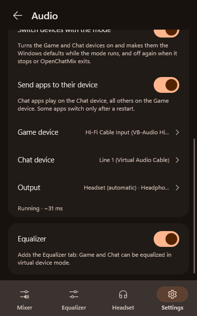
   </p>

2. With *Switch devices with the mode* on (the default), the Game and Chat devices are enabled while
   the mode runs. Game becomes the Windows default output and Chat the default communications device.
   When the mode is turned off or OpenChatMix exits, the previous defaults come back and both devices
   are disabled again, so apps fall back to the headset instead of going silent.
3. With *Send apps to their device* on (the default), apps in the Chat group play on the Chat device
   and all other apps on the Game device, as if chosen in Windows' per-app sound settings. Some apps
   switch only after a restart; apps with their own output setting (Discord, OBS) should use
   *Default*. When the mode is turned off or OpenChatMix exits, these apps return to the default
   device. Turn the option off to choose devices yourself.

**Media** needs a virtual cable of its own in this mode, for example a third VB-Audio or Virtual Audio
Cable; which one is up to you, and it must not be the cable your microphone plays into. Media apps are
then sent to it, ChatMix never changes it, its own Windows volume does, and it can play on another
output, such as speakers, while Game and Chat stay on the headset. It gets a channel of its own on the
*Equalizer* tab. Without a Media device, Media apps play on the Game side. Apps that play straight to
the headset are not affected.

OpenChatMix captures what is played on the two devices (WASAPI loopback) and plays it on the output
with the ChatMix balance applied, adding about 40 ms of latency. The panel shows what the bridge adds;
the device's own delay comes on top (a few milliseconds over USB, far more over Bluetooth).

The Windows volume and mute of the Game device apply to every channel that plays on the same output as
Game, so the taskbar slider and the volume keys work as usual while it is the default output. The
volume of the Chat device applies to the Chat side only, and that of the Media device to Media. A
level above 0 dB, such as the +12 dB of Virtual Audio Cable at 100%, plays at the original level. Apps
that record the Game or Chat device themselves, such as OBS, get the sound before ChatMix and the
device volume, at full level.

OpenChatMix cannot install a virtual audio device itself: that takes a signed kernel driver, and
bundling VB-CABLE with other software needs a distribution agreement with VB-Audio. The open-source
virtual audio drivers available today are unsigned and only load in Windows test mode, which requires
turning off Secure Boot and is refused by many anti-cheat systems.

### Equalizer

In virtual device mode the Game and Chat audio passes through OpenChatMix, so it can be equalized
for any headset, SteelSeries or not. The *Equalizer* tab has a 10-band parametric EQ for each side,
drawn like Sonar's: drag a numbered point to set its frequency and gain, scroll over it to make it
wider or narrower (Q), double-click it to reset its gain. The graph stays in view while the band
below it is edited. Each band can be a peak, low or high shelf, low or high pass, or notch filter.
The preamp lowers the level before boosts, and a soft limiter keeps boosted audio from clipping.
The equalizer adds no latency. If you do not need it, turn it off in *Settings → Audio*; the tab
then disappears.

As in Sonar, each side also has one-knob effects that presets leave alone:

- **Bass Boost**, **Voice Clarity** and **Treble Boost**, up to +12 dB each;
- **Smart Volume** (Quiet, Balanced or Loud), which evens out loud and quiet moments: it lowers
  explosions quickly and raises quiet passages slowly, by up to 9 dB, and leaves silence alone.

Virtual surround is not included; Windows Sonic for Headphones (in the Windows sound settings) works
with any headset.

Presets come from three places:

- built-in presets: Flat, Bass Boost, Footsteps, Treble Boost, V-Shape, Clear Dialog and Night for
  Game; Flat, Clear Voice, Warm Voice, Less Harsh and Radio for Chat; Flat, Voice Clarity, Broadcast,
  Bass Cut, Less Nasal and Less Sibilance for the microphone;
- the game, chat, media and microphone presets of SteelSeries GG, if it is installed: Sonar's, plus
  Engine's game and microphone presets that Sonar lacks. They are read from GG's local databases and are
  not shipped with OpenChatMix;
- your own presets, saved as files in `%APPDATA%\OpenChatMix\Presets\Parametric`.

The preset menus filter as you type. In an app profile, the *Game equalizer* menu starts with GG's
presets made for that game, under *For this game*.

**Plugins.** Below the effects, Game, Chat and Media each have a *Plugins* list like the microphone's:
any VST 2 (`.dll`) or VST 3 (`.vst3`) effect, top to bottom; drag them to reorder and click one to open
its window. A convolver with impulse responses, crossfeed, a loudness or a bass plugin you own shapes
the sound like a system-wide effects suite, without installing a driver. Plugins run in stereo at the
channel's own sample rate, before its volume, so a compressor does not undo the ChatMix balance; when a
sound stops they get silence until their latency and reverb tail have played out (at most 3 seconds).
The hint above the list shows what they delay the channel by. Nothing is loaded for a channel without
plugins; they load with virtual device mode and the equalizer, and their settings are kept in
`%APPDATA%\OpenChatMix\PluginStates`. On Chat, [`DeepFilterNet-OpenChatMix.dll`](https://github.com/Swiftlyx/OpenChatMix/releases/latest/download/DeepFilterNet-OpenChatMix.dll)
removes noise from the voices of others: it filters the mix of both sides at 48 kHz and adds about 30 ms.
NVIDIA's `NVAudioEffects.dll` (see [Microphone](#microphone)) works there too, at 48 kHz.

### Microphone

The microphone chain records your microphone, runs it through the effects and plays the result into
a virtual cable. Apps then use the other end of the cable as their microphone.

1. Install [VB-Audio VB-CABLE](https://vb-audio.com/Cable/) (free). Its *CABLE Input* is picked on
   its own; any other virtual cable can be chosen in the card.
2. *Settings → Microphone* → turn on *Process the microphone*. The Windows default microphone is
   used unless you choose another one.
3. In Discord, OBS, the game or *Settings → System → Sound*, choose **CABLE Output** as the
   microphone.

<p align="center">
  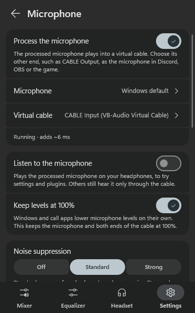
</p>

The effects run at 48 kHz, in blocks of 10 ms. By default the order is the one below; drag the steps
under *Processing order* to change it, for example to run a plugin before the noise suppression:

- **Noise suppression** with [RNNoise](https://github.com/xiph/rnnoise), a small neural network that
  removes fans, keyboards and room noise while keeping the voice. *Strong* also closes a gate while
  RNNoise hears no speech.
- **Equalizer**: the same 10-band parametric EQ as for Game and Chat, with presets made for voices
  (Voice Clarity, Broadcast, Bass Cut, Less Nasal, Less Sibilance) and the microphone presets of a
  local SteelSeries GG installation.
- **Compressor** (Light, Medium, Strong): makes quiet speech louder and loud speech quieter, and keeps
  the room noise between words down instead of raising it.
- **Plugins**: any VST 2 (`.dll`) or VST 3 (`.vst3`) effect, top to bottom; drag them to reorder.
  Click a plugin to open its own window; its settings are kept in `%APPDATA%\OpenChatMix\PluginStates`.
  Plugins run on their own thread, as mono; stereo plugins get the microphone on both sides.
- **AI noise suppression** (optional): download [`DeepFilterNet-OpenChatMix.dll`](https://github.com/Swiftlyx/OpenChatMix/releases/latest/download/DeepFilterNet-OpenChatMix.dll) and add it under
  *Plugins*. It is OpenChatMix's build of [DeepFilterNet](https://github.com/Rikorose/DeepFilterNet), a neural network that removes noise more
  thoroughly than RNNoise, with its DeepFilterNet3 model inside (about 17 MB). *Max noise reduction*
  (6–60 dB or unlimited) and *Post-filter* appear below the plugin list. It adds about 20 ms and takes
  about 3% of one CPU core; nothing of it is loaded until you add it.
- **NVIDIA noise removal** (optional, RTX graphics cards): install NVIDIA's Audio Effects redistributable
  for your card from [NVIDIA's SDK page](https://www.nvidia.com/broadcast-sdk-resources), then add `NVAudioEffects.dll` from `C:\Program Files\NVIDIA Corporation\NVIDIA Audio Effects SDK` under *Plugins*. It runs NVIDIA's
  models for noise and room echo (the ones behind NVIDIA Broadcast) on the graphics card; *Effect* and
  *Strength* appear below the plugin list. The model loads in the background within a few seconds, and
  the sound passes unchanged until then.
- A limiter at the end keeps the result from clipping.

The chain adds about 30–50 ms of latency, depending on the devices. With *Keep levels at 100%* on,
OpenChatMix sets the microphone and both ends of the cable back to 100% whenever Windows or a call
app lowers them; mute stays yours. Windows' own "reduce other sounds during calls" leaves the
processed microphone alone, and ducking only ever lowers the Game side of ChatMix.

*Listen to the microphone* also plays the processed microphone on the current output device, to
check the effects and plugins by ear. Only you hear it; other apps still get the microphone through
the cable. While it is on, a meter shows the level against 0 dBFS: speech peaking around −12 dB is
right, and the peaks should stay below 0 dB.

Device lists show connected, enabled devices only. Turn on a disabled one in *Settings → System →
Sound → All sound devices*. The output and microphone pickers also leave out virtual cables.

### Screensaver and visualizer (Arctis Nova Pro)

The GameDAC and the Nova Pro Wireless base station have a 128×64 OLED that shows the same screen
for hours when nothing plays. The screensaver replaces it after a chosen delay (15 s to 10 min)
without sound. Any sound, turning the knob or a change made in OpenChatMix brings the usual
screen back at once, so the level meters still show while audio plays. The *Screensaver on/off* hotkey
keeps it on until you press it again, sound or not; turning the knob or a change made in OpenChatMix
then shows the usual screen for three seconds.

<p align="center">
  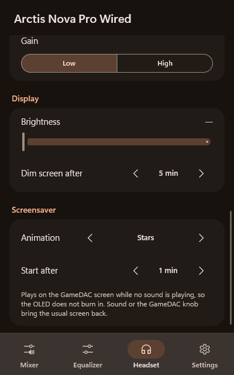
</p>

- **Stars**, **Clock** (time and date in your Windows regional format, slowly drifting),
  **Game of Life** and **Screen off**.
- **Image or GIF**: any GIF, PNG, JPEG or BMP, letterboxed to 128×64 and dithered. Animated GIFs
  play in real time — bring your own *Bad Apple!!*. A still image moves by a pixel every half minute.
  Large files are decoded on the display's own thread at low priority and never block the app; images
  over 100 megapixels, broken GIF frames and anything that runs out of memory are refused instead of
  taking OpenChatMix down, and of very long GIFs the first part is played.

Each drawing report takes the GameDAC about 30 ms, so a full-screen animation runs at about
15 frames per second; small moving objects update faster because only the changed area is sent.
When OpenChatMix exits or the PC goes to sleep, the display is handed back to the GameDAC.

**Visualizer.** *Headset → Visualizer* fills the screen with 32 bars from 20 Hz to 20 kHz, with falling
peak marks, while something plays: music and video (an app that tells the media controls of Windows it
plays) or any sound. It runs at about 17 to 23 frames a second, as fast as the GameDAC takes them.
Turning the knob or a change made in OpenChatMix shows the usual screen for three seconds; a screensaver
turned on by the hotkey goes first.

**Add-on screens** ([3rd party add-ons](#features)) go over the screensaver, the visualizer or the
GameDAC's own screen for as long as they last; then the screen they covered comes back.

## How it works

**Headset.** OpenChatMix opens the vendor HID interface of the headset and uses these reports:

| Headset | Direction | Report | Meaning |
| --- | --- | --- | --- |
| Nova Pro (interface 4) | PC → device | `06 49 01` / `06 49 00` | Dial controls ChatMix / volume only |
| | PC → device | `06 8D 01` / `06 8D 00` | Show / hide the ChatMix icon |
| | PC → device | `06 45 gg cc` | Set the balance (game, chat 0–100) |
| | device → PC | `07 45 gg cc` | Dial turned in ChatMix mode |
| | device → PC | `07 25 vv` | Knob turned in volume mode; `vv` is the attenuation, 0 the loudest and 56 the quietest (the Nova Elite sends the same) |
| | PC → device | `06 20` | Query settings: reply `06 20` with gain (byte 4), EQ preset (6), 10 EQ bands (7–16), mic volume (17), sidetone (18) — verified on a Nova Pro Wired |
| | PC → device | `06 2E n` / `06 33 b1…b10` | EQ preset (4 = custom) / custom bands, `0x14` = 0 dB, 0.5 dB steps |
| | PC → device | `06 37` `06 39` `06 27` `06 85` `06 83` | Mic volume, sidetone, gain (1 Low, 2 High), display brightness, screen dimming |
| | PC → device | feature `06 93 x y w h …` | Draw on the 128×64 display: up to 64 columns, height in multiples of 8, pixels column by column |
| | PC → device | `06 95` | Hand the display back to the GameDAC |
| Nova Pro Wireless | PC → device | `06 B0` | Status: Bluetooth at power-on (byte 2) and during calls (3), its mode and link (4–5), battery 0–8 (6), spare battery 0–8 (7), transparency level (8), noise control (10: 0 off, 1 transparency, 2 ANC), mute LED (11), auto-off (12), wireless mode (13), headset state (15) |
| | PC → device | `06 BD m` · `06 B9 n` · `06 B2` · `06 B3` | Noise control, transparency level 1–10, Bluetooth at power-on, during calls |
| | device → PC | `07 B7 hh ss cs` · `07 BD m` · `07 B9 n` | Battery event (headset and spare 0–8, state); noise control and transparency changed on the headset |
| Nova 7 / 7+ / 5X (interface 3) | PC → device | `00 B0` | Status request, polled every 100 ms until dial events arrive, then every 30 s for the battery |
| | device → PC | `B0 …` | Status: battery at byte 2 (Nova 5X: 3), 0–100 or 0–4 on older models; game and chat at bytes 4 and 5 (Nova 5X: chat 5, game 6) |
| | device → PC | `45 gg cc` | Dial event (Gen 2 firmware); polling stops once seen |
| | PC → device | `00 33 b1…b10 00` | Custom EQ bands on the original Nova 7 firmware, `0x14` = 0 dB, 0.5 dB steps |
| Nova Elite (interface 3, experimental) | PC → device | `01 8D 01` · `01 49 01` | As on the Nova Pro, with report ID `0x01` |
| | PC → device | `01 B0` | Status: Bluetooth at bytes 4–5, battery 0–100 at 6, spare battery at 7, headset link at 14 (`08` connected), charging at 15 (`02` charging) |
| | device → PC | `07 45 gg cc` · `07 B7 hh ss cs` | Dial event; battery event (headset %, spare %, charging state) |
| | PC → device | `01 37` `01 BF` `01 BD` `01 B8` `01 B9` `01 27` `01 85` `01 83` `01 89` `01 C1` `01 B2` `01 B3` | Settings (experimental): mic volume, mute LED, noise control (0 off, 1 transparency, 2 ANC), ANC level, transparency level, volume limiter, brightness, dimming, home screen, auto-off, Bluetooth at power-on, during calls; line out and stream mix as on the Nova Pro; `01 09` saves 500 ms later |
| | PC → device | feature `01 1B k a… n… f…` (1036 bytes) | Equalizer (experimental): kind (4 custom, 5 a GG game preset), a 6-byte alias, a 61-byte name, then ten filters of frequency (u16 LE), type (1 peak), gain (i8, 0.1 dB) and Q (u16 LE, ×1000); the rest zeros |
| | PC → device | `01 38 on level` · `01 39 on level` | Sidetone of the boom and the built-in microphone |
| | PC → device | `01 80` | Query the display: dimming (byte 2), brightness (3), home screen (5); `01 B0` also holds Bluetooth at power-on (2), during calls (3), transparency (8), noise control (10), mute LED (11), auto-off (12), ANC level (16) |
| Nova 7 Gen 2 protocol | PC → device | `00 A7 00 01 name` · `00 33 00 f1…f10` · `00 27` | Parametric EQ (experimental): the preset name, ten filters of frequency (u16 big-endian), type (1 = peak), gain (signed, 0.1 dB) and Q × 1000 (u16 little-endian), then apply; `00 09` saves |

**Audio.** The balance is applied with the Windows audio session API on the headset's playback
device, so there is no extra audio path and no added latency. `IAudioSessionManager2` lists the apps
and `IChannelAudioVolume` lowers them through the per-channel volume of their session, which Windows
multiplies with the app's slider in the volume mixer. Windows keeps that volume for the app's next
start, so OpenChatMix resets it as soon as the app exits. In virtual device mode loopback capture
takes the sound before the Windows volume of the Game and Chat devices, so the bridges read it
(`IAudioEndpointVolume`) and apply it themselves. The screensaver watches the device's peak meter
(`IAudioMeterInformation`). Virtual device mode switches devices and defaults through the
`IPolicyConfig` interface that the Windows sound settings use, and sends apps to the Game or Chat
device through `IAudioPolicyConfigFactory`, the interface behind the per-app device choice in the
Windows volume mixer; neither needs administrator rights. The equalizer is a chain of biquad filters
computed in double precision. Plugins on Game, Chat and Media run on the bridge's own MMCSS thread, in
blocks of up to 20 ms; the plugin list reaches it without a lock the audio thread could wait on.

**Microphone.** A WASAPI capture stream of the microphone and a render stream into the cable, both
at 48 kHz mono with Windows converting from and to the devices' formats, on an MMCSS "Pro Audio"
thread. RNNoise 0.1.1 runs in its native 10 ms frames. VST 3 plugins are hosted on the interfaces of
the [VST 3 SDK](https://github.com/steinbergmedia/vst3_pluginterfaces) (MIT), VST 2 plugins through
their published binary interface; both, with their editor windows, live on a separate thread with a
single-threaded COM apartment, as plugin user interfaces expect. The render session opts out of
Windows' communications ducking (`IAudioSessionControl2::SetDuckingPreference`).

**GameDAC screen.** The screensaver, the visualizer and add-on screens are drawn by a thread of their
own through a handle of its own to the GameDAC's HID interface, so drawing never holds up ChatMix
commands. The visualizer listens to the headset with WASAPI loopback only while it shows and splits the
sound into 32 bands from 20 Hz to 20 kHz with a 4096-point FFT; whether music or video plays comes from
the media sessions Windows lists (`GlobalSystemMediaTransportControlsSessionManager`). To give way to
SteelSeries GG's own apps for the display, OpenChatMix watches the I/O of their helper processes while
GG runs and the screensaver is on (`GetProcessIoCounters`): the moment a helper hands GG something to
show, the screensaver stops; the regular heartbeat each helper sends is learned and ignored. Add-ons
talk to a GameSense receiver on 127.0.0.1 with a free port, whose address goes into
`%ProgramData%\SteelSeries\SteelSeries Engine 3\coreProps.json` while they run and is put back
afterwards; requests a web page could send are refused. Add-ons run in a job object, so they end with
OpenChatMix.

**Settings** live in `%APPDATA%\OpenChatMix\OpenChatMix.ini`. If an `OpenChatMix.ini` file is placed
next to the executable, it is used instead (portable mode).

## Building from source

Requirements: Windows 10 or 11 and Visual Studio 2022 (or the Build Tools) with the
*Desktop development with C++* workload. The two third-party libraries are part of the repository
under `third_party/` (see [THIRD_PARTY_NOTICES.md](THIRD_PARTY_NOTICES.md)).

```bat
build.bat                      :: builds build\OpenChatMix.exe
powershell -File package.ps1   :: builds and packages dist\OpenChatMix.exe and the release zip
tools\icongen\build.bat        :: regenerates assets\OpenChatMix.ico from code
tools\preview\build.bat        :: builds build\preview\OpenChatMixPreview.exe (after build.bat)
```

`OpenChatMixPreview.exe` shows the real panel with a simulated headset, to look at every page without
the hardware: its tray icon's menu picks the model (each family, another headset, speakers or none),
the battery, Bluetooth, SteelSeries GG and the update state. It opens no device and changes nothing in
Windows; at each start it copies your settings next to itself and keeps its changes there. Started with
`--screenshots`, it keeps the settings already next to it and lists a fixed set of apps, as for the
pictures in this README; `--headset N` starts with the N-th model of its menu.

```
src/            application (Win32, WASAPI, HID, Direct2D, microphone chain, plugin host)
src/ui/         Material 3 panel, popup and drawing helpers
third_party/    RNNoise and the VST 3 SDK interfaces
assets/         app icon
tools/icongen/  icon generator
tools/preview/  the panel with a simulated headset
tools/drift_sim.cpp  simulation of the audio queue between two device clocks
docs/           screenshots and the design system (docs/design-system.md)
```

The panel follows a design system based on Material 3 Expressive: spacing, shapes, color roles, type,
spring motion and components, described in [docs/design-system.md](docs/design-system.md). The tokens
are in `src/ui/design.h`.

## Troubleshooting

- **The dial does nothing or the volume knob seems dead.** Make sure SteelSeries GG / Sonar is not
  running — the panel shows a warning while it is. Then use *Reconnect headset* from the tray menu,
  or unplug and reconnect the headset.
- **An app is not affected.** OpenChatMix controls apps that play through the headset (or through
  the default output when no headset is connected). Check the app's output device.
- **An app plays on the wrong device in virtual device mode.** Some apps keep their audio device
  until they restart. Apps with their own output setting must use *Default* to follow the Game or
  Chat device.
- **Native settings on untested models.** Settings were taken from the projects below and checked on
  a Nova Pro Wired; on other models a setting may do nothing or behave differently. Please report it.
- **A hotkey is shown in red.** Another app already uses that combination; pick a different one.
- **The screensaver does not start.** It waits for the chosen delay without any sound on the headset.
  Apps that keep a stream open but play silence do not count. SteelSeries GG may draw on the display
  too while it runs.
- **"Windows did not switch the devices"** in virtual device mode. Another app or a policy blocked
  the change; switch the devices in *Settings → System → Sound* or turn off *Switch devices with the
  mode*.
- **Discord or the game does not hear the processed microphone.** Choose *CABLE Output* (the
  recording side of the cable in *Settings → Microphone*) as the input there, not the microphone
  itself. If *Settings → Microphone* says there is no cable, install VB-CABLE or choose a cable.
- **Crackling in virtual device mode or on the processed microphone.** Turn on the log (below) and
  play for a few minutes. Lines like `bridge: output ran dry …` or `mic: cable ran dry …` mean the
  output ran out of audio. `capture gaps` / `microphone gaps` mean the audio thread woke too late
  (CPU load, a slow plugin or a driver), and the `speed` value shows how far apart the devices'
  clocks are. With no such lines, the crackle comes from elsewhere, e.g. the virtual cable's own
  buffer (*VB-CABLE Control Panel → Max Latency*) or a USB hub.
- **The visualizer does not show.** With *Music and video* it shows only while an app tells Windows it
  plays — its controls then appear in the Windows media flyout next to the volume. Some games and apps
  do not; choose *Any sound* for them.
- **An add-on shows nothing.** Add-ons run only while SteelSeries GG is closed and a GameDAC with its
  display is connected; the *3rd party add-ons* page says what is missing. Some add-ons read GG's address
  only when they start: turn *Start with OpenChatMix* off and on again on the add-on's page.
- **A plugin "could not be loaded".** Only 64-bit effect plugins work; instruments and 32-bit plugins
  do not. For a VST 3 bundle, choose the `.vst3` folder's inner file
  (`Contents\x86_64-win\Name.vst3`) or the bundle itself.
- **NVIDIA Audio Effects says the model did not load.** It needs an NVIDIA RTX card and NVIDIA's Audio
  Effects redistributable for that card's generation (RTX 20, 30, 40 or 50 series). With the log on,
  the lines starting with `nvafx:` name the reason.
- **Collecting a log.** Turn on *Settings* → *General* → *Diagnostics* → *Write a log* and reproduce
  the problem; *Open the log folder* shows `OpenChatMix.log`. (Setting `Log=1` in
  `%APPDATA%\OpenChatMix\OpenChatMix.ini` while OpenChatMix is closed works too.) The log records every
  report from the headset. With a SteelSeries headset OpenChatMix does not support yet, the log lists its
  HID collections and the reports it sends (only read, nothing is sent to it): turn the dial, press its
  buttons, then attach the log to an issue. If OpenChatMix stops responding while the log is on, it also
  writes `OpenChatMix-hang-<time>.dmp` there; please attach that as well.

## Acknowledgements

Apart from RNNoise and the VST 3 SDK interfaces, which are included as marked, and DeepFilterNet in the
optional plugin, OpenChatMix contains no code from the projects below, but it would not exist without the
protocol details they documented:

- [nova-chatmix-linux](https://github.com/Dymstro/nova-chatmix-linux) by Dymstro — the Nova Pro
  ChatMix enable (`0x49`), ChatMix icon (`0x8D`) and `0x45` report format.
- [HeadsetControl](https://github.com/Sapd/HeadsetControl) by Sapd and contributors — USB product IDs,
  status report layouts (ChatMix and battery), equalizer formats and the SteelSeries EQ preset curves for
  the Arctis Nova 7, 7+ and Nova 5 families and the Nova Pro Wireless; the Nova Elite captures in
  [HeadsetControl #481](https://github.com/Sapd/HeadsetControl/issues/481).
- [Linux-Arctis-Manager](https://github.com/elegos/Linux-Arctis-Manager) by elegos — device
  definitions and native settings (microphone, sidetone, gain, display, power, wireless, Bluetooth)
  for the Nova Pro, Nova 7, Nova 5 and Arctis 7+, and the Nova 7 Gen 2 parametric equalizer format.
- [NovaPanel](https://github.com/thibautgnt/NovaPanel) by thibautgnt — the Nova Pro Wireless noise control, transparency and Bluetooth commands and
  the spare battery in its status (MIT).
- [ggoled](https://github.com/JerwuQu/ggoled) by JerwuQu — the Nova Pro OLED drawing protocol
  (`0x93` draw report, `0x95` return to the device's interface), and the Bad Apple demo that
  inspired the screensaver.
- The [GameSense SDK](https://github.com/SteelSeries/gamesense-sdk) by SteelSeries — the protocol that
  3rd party add-ons speak, as documented there.
- [EarTrumpet](https://github.com/File-New-Project/EarTrumpet) by File-New-Project — the layout and
  interface IDs of `IAudioPolicyConfigFactory` for per-app playback devices.
- Robert Bristow-Johnson's *Audio EQ Cookbook* — the filter formulas of the equalizer.
- The [NVIDIA Maxine Audio Effects SDK](https://github.com/NVIDIA-Maxine/Maxine-AFX-SDK) — the C API
  (function and parameter names, MIT) that the optional NVIDIA plugin calls; the SDK itself is NVIDIA's
  redistributable, installed by the user.
- [RNNoise](https://github.com/xiph/rnnoise) by Jean-Marc Valin, Xiph.Org and Mozilla — the noise
  suppression of the microphone chain, included in `third_party/rnnoise` (BSD 3-clause).
- [DeepFilterNet](https://github.com/Rikorose/DeepFilterNet) by Hendrik Schröter — the AI noise suppression and its DeepFilterNet3 model in
  the optional `DeepFilterNet-OpenChatMix.dll` (MIT or Apache-2.0), running on
  [tract](https://github.com/sonos/tract) by Sonos (MIT or Apache-2.0). Built from `tools/deepfilter`.
- The [VST 3 SDK](https://github.com/steinbergmedia/vst3_pluginterfaces) interfaces by Steinberg
  Media Technologies, included in `third_party/vst3` (MIT). VST is a trademark of Steinberg Media
  Technologies GmbH.
- The [hid-steelseries Arctis patch series](https://lkml.iu.edu/2602.3/08373.html) for the Linux
  kernel — ChatMix parsing for the Nova Pro, Nova 7 Gen 2 events and the Nova 5X byte order.
- USB captures of the Arctis Nova Pro Wired GameDAC by Swiftlyx (me).
- [Fenderenko](https://github.com/fenderenko/) — ideas for improving the app.
- The interface follows [Material Design 3](https://m3.material.io/); icons come from Segoe Fluent
  Icons, which ship with Windows.

## Disclaimer

OpenChatMix is an independent project and is not affiliated with or endorsed by SteelSeries.
SteelSeries, Arctis, GameDAC, Sonar and ChatMix are trademarks of SteelSeries ApS.

OpenChatMix includes no SteelSeries software. A 3rd party add-on is a program you choose and run
yourself; OpenChatMix starts the file you picked and understands GameSense, the protocol SteelSeries
publishes for programs that talk to its devices.

## License

[MIT](LICENSE) © 2026 Swiftlyx
