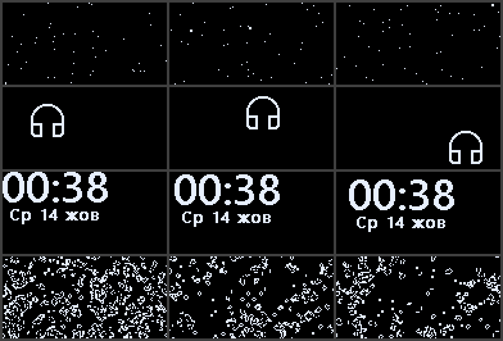

<p align="center">
  
</p>

<h1 align="center">OpenChatMix</h1>

<p align="center">
  Lightweight ChatMix for SteelSeries Arctis headsets on Windows — no SteelSeries GG, no Sonar.
</p>

---

On Windows, the ChatMix dial of newer Arctis headsets only works while SteelSeries GG and Sonar are
running: several background processes, hundreds of megabytes of RAM and a set of virtual audio
devices, just to balance game and chat audio.

OpenChatMix talks to the headset directly over USB HID and applies the balance as per-app volume
in Windows. It is a single native executable of about 1 MB that idles at 0% CPU, installs no
drivers and creates no virtual audio devices.

<p align="center">
  
  &nbsp;
  
  &nbsp;
  
</p>

## Features

- **Hardware dial.** The GameDAC / base station dial drives the Game–Chat balance. While
  OpenChatMix runs, the ChatMix icon is shown on the GameDAC display, so a glance tells you it is active.
- **Volume stays hardware.** Only ChatMix reports are used; turning the knob in volume mode keeps
  working as before. The panel shows which mode the dial is in.
- **Game / Chat / Media groups.** Unknown apps follow the Game side, Discord starts in Chat, and
  Media apps (music, videos) are never touched by ChatMix — like Sonar's Media channel. The Media
  group can be turned off if you do not need it.
- **Manual assignment.** Open a group and add any running app, or browse for an `.exe`, even if it
  is closed.
- **Native headset settings**, shown only for the connected model: the 10-band Engine EQ with the
  SteelSeries presets (Flat, Bass Boost, Focus, Smiley) and a custom curve, microphone volume,
  sidetone, mic mute LED, gain, volume limiter, GameDAC brightness and screen dimming, auto power-off,
  2.4 GHz mode, Bluetooth options and battery level, depending on the headset.
- **Game presets on the headset itself.** Any game preset (built-in or from Sonar) can be put on the
  headset's own Engine EQ, converted to its ten bands, so it works without virtual devices too.
- **EQ presets as files.** Save the current curve, import presets from others, keep backups.
- **Screensaver for the GameDAC display** (Nova Pro). While no sound plays, an animation, a clock
  or your own image or GIF keeps the OLED from burning in. Any sound brings the usual screen back.
- **Virtual device mode (optional).** Instead of changing app volumes, mix Game and Chat from two
  virtual audio cables into the headset, like Sonar does. Chat apps are sent to the Chat cable and
  all other apps to the Game cable on their own. The cables are switched on and made the Windows
  defaults only while the mode runs.
- **Equalizer for any headset** (virtual device mode, optional). A 10-band parametric EQ for Game
  and for Chat with a response graph like Sonar's, Bass Boost, Voice Clarity, Treble Boost and Smart
  Volume, built-in presets, your own preset files and the presets of a local SteelSeries Sonar
  installation.
- **Hotkeys with an on-screen popup** (`Ctrl + Alt + ← / → / ↓` by default), plus optional hotkeys
  to mute chat and to switch to the next EQ preset. A single key works as well, so a keyboard's
  volume knob can become a ChatMix wheel. Hotkeys also work without a SteelSeries headset: the
  balance is then applied to the default output device.
- **Exact balance without a ChatMix headset.** With a headset dial the balance keeps to its 12 steps
  per side, so the app and the GameDAC always agree. Without one, the slider and the arrow keys move
  it by single percents; the mouse wheel and the hotkeys by 10%.
- **Optional extras**, each with its own switch: lower the game while someone talks in chat
  (ducking), game profiles that change the balance and EQ while a game runs, a popup for the ChatMix
  wheel on headsets without a display, and a low battery warning for wireless headsets.
- **Material 3 tray panel** with an automatic, light or dark theme, the Windows accent color, eight
  presets or any custom color, and an Acrylic, Mica or solid background. Animations run at the
  monitor's refresh rate, including 144 Hz and 240 Hz screens, and can be reduced. The tray icon
  shows Game and Chat as two bars that shrink with their level; it can be colored or monochrome.
- **English and Ukrainian** interface.
- Starts with Windows, reconnects after sleep, unplugging or SteelSeries GG releasing the headset.
- Warns once (and in the panel) if SteelSeries GG starts while a SteelSeries headset is connected;
  the warning can be hidden or turned off, and never appears for other headsets.
- **Updates from GitHub** (optional): once a day OpenChatMix asks the project's GitHub releases for
  a newer version. *Install* downloads it, checks it against the release's `SHA256SUMS.txt` and
  restarts. Turn the check off in *Settings → Updates*.
- No telemetry. The update check is the only network access.

<p align="center">
  
  &nbsp;
  
</p>

<p align="center">
  
  &nbsp;
  
</p>

## Supported headsets

| Headset | USB product IDs | Status |
| --- | --- | --- |
| Arctis Nova Pro Wired (PC, Xbox) | `12CB`, `12CD` | ✅ Tested |
| Arctis 7+ / 7P+ / 7X+ / 7+ Destiny | `220E`, `2212`, `2216`, `2236` | ✅ Tested (Arctis 7+) |
| Arctis Nova Pro Wireless (PC, Xbox) | `12E0`, `12E5` | Untested — same protocol as Nova Pro Wired |
| Arctis Nova 7 / 7X / 7 Gen 2 / Diablo IV / WoW | `2202`, `22A1`, `227E`, `2206`, `2258`, `229E`, `22AD`, `22A4`, `22A5`, `223A`, `22A9`, `227A` | Untested |
| Arctis Nova 5X | `2253`, `2264` | Untested — Game and Chat may be swapped |

Not supported: the **Arctis Nova 7P** (its dial controls sidetone, not ChatMix). The original
**Arctis 7, 9 and Pro Wireless** mix game and chat in hardware through two playback devices and do
not need an app.

Reports for other models are very welcome — see [Troubleshooting](#troubleshooting) for how to
collect a log.

## Getting started

1. Download `OpenChatMix.exe` (or the zip) from the [Releases](../../releases) page.
2. Quit SteelSeries GG completely (tray icon → Exit) and disable it in
   *Task Manager → Startup apps*. GG and OpenChatMix cannot control the headset at the same time.
3. In *Settings → System → Sound*, choose the headset itself (for example
   *Headphones (Arctis Nova Pro)*) as the output device instead of *SteelSeries Sonar – Gaming*.
   In Discord and other apps, set the output to *Default* or to the headset.
4. Run `OpenChatMix.exe`. A tray icon with two bars (Game and Chat) appears; click it to open the panel.

The executable is not code-signed, so Windows SmartScreen may ask for confirmation on the first run
(*More info → Run anyway*).

**Antivirus warnings.** Some antivirus programs distrust new, unsigned executables, especially ones
that talk to USB devices, start with Windows and can replace themselves when an update is
installed. A warning about OpenChatMix is a false positive. To be sure you have the genuine file,
compare `Get-FileHash OpenChatMix.exe` with `SHA256SUMS.txt` from the same release, read the source
code in this repository, or [build it yourself](#building-from-source). Please report false
positives to your antivirus vendor; for Microsoft Defender use the
[file submission page](https://www.microsoft.com/wdsi/filesubmission).

## Usage

| Action | How |
| --- | --- |
| Change the balance | GameDAC: press the knob to switch it to ChatMix, then turn it. Other headsets: turn the ChatMix wheel. |
| | *Mixer* tab: drag the slider, scroll over it, or use ← / →. Double-click centers it. |
| | Hotkeys: `Ctrl + Alt + ←` more game, `Ctrl + Alt + →` more chat, `Ctrl + Alt + ↓` balanced. |
| Move an app between groups | *Mixer* → *Groups* → open a group → *Game / Chat / Media* next to the app. |
| Add an app manually | Open a group → *Add* → pick a running app or *Browse .exe*. |
| Theme, color, background | *Settings* → *Appearance*. |
| Hotkeys, popups, battery warning | *Settings* → *Hotkeys* / *Notifications*. |
| Language, startup | *Settings* → *General*. |
| Recover the headset | Tray menu → *Reconnect headset*. |
| Headset settings and EQ | *Headset* tab (shown when a supported headset is connected). |
| Save, import or back up EQ presets | *Headset* tab → *Save* / *Import* / *Folder*. Presets live in `%APPDATA%\OpenChatMix\Presets`. |
| Screensaver on the GameDAC | *Headset* tab → *Screensaver* → pick an animation and the delay. |
| Virtual device mode, Media group, ducking | *Settings* → *Audio*. |
| Equalizer for Game and Chat | *Equalizer* tab (virtual device mode). |
| Game profiles | *Settings* → *Game profiles* → *Add*. |

When OpenChatMix exits, every app it changed goes back to 100% volume and the GameDAC dial returns
to plain volume control.

Headset settings are only sent when you change them in the panel; OpenChatMix never overwrites the
headset's settings on its own. On the Nova Pro Wired the current EQ preset and curve, microphone
volume, sidetone, gain and ChatMix balance are read from the GameDAC when it connects and after every
change; display brightness and screen dimming are not reported by the device, so the panel shows the
values last set from OpenChatMix.

When a preset stored on the headset (Flat, Bass Boost, Focus, Smiley) is active, the Headset tab shows
its curve; choose *Custom* to edit the bands. *Game presets* puts a game preset on the headset as the
custom curve. If the current custom curve is not saved yet, it is first kept under *My presets*.

### Virtual device mode

1. Install two virtual audio cables. Any virtual audio cables work; this free setup is tested with
   OpenChatMix:

   | Role | Cable | License |
   | --- | --- | --- |
   | Game | [VB-Audio Hi-Fi Cable](https://vb-audio.com/Cable/) | free for end users |
   | Chat | [Virtual Audio Cable Lite](https://vac.muzychenko.net/en/download.htm) | free for home use; one cable, 48 kHz / 16-bit |
   | Microphone chain (optional) | [VB-Audio VB-CABLE](https://vb-audio.com/Cable/) | free |

   Several apps (say Discord and Telegram) can play into VAC Lite at once: Windows mixes them into the
   single stream the Lite edition allows. [VB-CABLE A+B](https://vb-audio.com/Cable/) (donationware)
   works as well. *CABLE Input* and *CABLE In 16ch* of the basic VB-CABLE are two inputs of the same
   cable and cannot serve as separate devices; OpenChatMix leaves them to a microphone chain.

   Then Settings → *Audio routing* → enable *Virtual device mode* and choose the Game and Chat devices
   in the same card. VB-Audio Hi-Fi Cable, Virtual Audio Cable and VB-CABLE A–D are recognized and
   assigned on their own, also when they are installed while OpenChatMix runs. The output defaults to
   the connected headset.

   The *SteelSeries Sonar* devices that SteelSeries GG installs cannot be used: even with GG closed,
   Sonar passes their sound to the headset by itself, so everything would be heard twice.

   <p align="center">
     
   </p>

2. With *Switch devices with the mode* on (the default), the Game and Chat devices are enabled while
   the mode runs. Game becomes the Windows default output and Chat the default communications device.
   When the mode is turned off or OpenChatMix exits, the previous defaults come back and both devices
   are disabled again, so apps fall back to the headset instead of going silent.
3. With *Send apps to their device* on (the default), apps in the Chat group play on the Chat device
   and all other apps on the Game device, as if chosen in Windows' per-app sound settings. Some apps
   switch only after a restart; apps with their own output setting (Discord, OBS) should use
   *Default*. When the mode is turned off or OpenChatMix exits, these apps return to the default
   device. Turn the option off to choose devices yourself.

There is no Media group in this mode: Media apps play on the Game side. Apps that play straight to
the headset are not affected.

OpenChatMix captures what is played on the two devices (WASAPI loopback) and plays it on the output
with the ChatMix balance applied, adding about 30 ms of latency. App volumes are reset to 100%
when the mode is turned on.

OpenChatMix cannot install a virtual audio device itself: that takes a signed kernel driver, and
bundling VB-CABLE with other software needs a distribution agreement with VB-Audio. The open-source
virtual audio drivers available today are unsigned and only load in Windows test mode, which requires
turning off Secure Boot and is refused by many anti-cheat systems.

### Equalizer

In virtual device mode the Game and Chat audio passes through OpenChatMix, so it can be equalized
for any headset, SteelSeries or not. The *Equalizer* tab has a 10-band parametric EQ for each side,
drawn like Sonar's: drag a numbered point to set its frequency and gain, scroll over it to make it
wider or narrower (Q), double-click it to reset its gain. The graph stays in view while the band
below it is edited. Each band can be a peak, low or high shelf, low or high pass, or notch filter.
The preamp lowers the level before boosts, and a soft limiter keeps boosted audio from clipping.
The equalizer adds no latency. If you do not need it, turn it off in *Settings → Audio*; the tab
then disappears.

As in Sonar, each side also has one-knob effects that presets leave alone:

- **Bass Boost**, **Voice Clarity** and **Treble Boost**, up to +12 dB each;
- **Smart Volume** (Quiet, Balanced or Loud), which evens out loud and quiet moments: it lowers
  explosions quickly and raises quiet passages slowly, by up to 9 dB, and leaves silence alone.

Virtual surround is not included; Windows Sonic for Headphones (in the Windows sound settings) works
with any headset.

Presets come from three places:

- built-in presets: Flat, Bass Boost, Footsteps, Treble Boost, V-Shape, Clear Dialog and Night for
  Game; Flat, Clear Voice, Warm Voice, Less Harsh and Radio for Chat;
- the game and chat presets of SteelSeries Sonar, if SteelSeries GG is installed: they are read
  from GG's local database and are not shipped with OpenChatMix;
- your own presets, saved as files in `%APPDATA%\OpenChatMix\Presets\Parametric`.

### Screensaver (Arctis Nova Pro)

The GameDAC and the Nova Pro Wireless base station have a 128×64 OLED that shows the same screen
for hours when nothing plays. The screensaver replaces it after a chosen delay (15 s to 10 min)
without sound. Any sound, turning the knob or a change made in OpenChatMix brings the usual
screen back at once, so the level meters still show while audio plays.

<p align="center">
  
  &nbsp;
  
</p>

- **Stars**, **Headphones** (bouncing icon), **Clock** (time and date in your Windows regional
  format, slowly drifting), **Game of Life** and **Screen off**.
- **Image or GIF**: any GIF, PNG, JPEG or BMP, letterboxed to 128×64 and dithered. Animated GIFs
  play in real time — bring your own *Bad Apple!!*. A still image moves by a pixel every half minute.

Each drawing report takes the GameDAC about 30 ms, so a full-screen animation runs at about
15 frames per second; small moving objects update faster because only the changed area is sent.
When OpenChatMix exits or the PC goes to sleep, the display is handed back to the GameDAC.

## How it works

**Headset.** OpenChatMix opens the vendor HID interface of the headset and uses these reports:

| Headset | Direction | Report | Meaning |
| --- | --- | --- | --- |
| Nova Pro (interface 4) | PC → device | `06 49 01` / `06 49 00` | Dial controls ChatMix / volume only |
| | PC → device | `06 8D 01` / `06 8D 00` | Show / hide the ChatMix icon |
| | PC → device | `06 45 gg cc` | Set the balance (game, chat 0–100) |
| | device → PC | `07 45 gg cc` | Dial turned in ChatMix mode |
| | device → PC | `07 25 vv` | Knob turned in volume mode |
| | PC → device | `06 20` | Query settings: reply `06 20` with gain (byte 4), EQ preset (6), 10 EQ bands (7–16), mic volume (17), sidetone (18) — verified on a Nova Pro Wired |
| | PC → device | `06 2E n` / `06 33 b1…b10` | EQ preset (4 = custom) / custom bands, `0x14` = 0 dB, 0.5 dB steps |
| | PC → device | `06 37` `06 39` `06 27` `06 85` `06 83` | Mic volume, sidetone, gain (1 Low, 2 High), display brightness, screen dimming |
| | PC → device | feature `06 93 x y w h …` | Draw on the 128×64 display: up to 64 columns, height in multiples of 8, pixels column by column |
| | PC → device | `06 95` | Hand the display back to the GameDAC |
| Nova 7 / 7+ / 5X (interface 3) | PC → device | `00 B0` | Status request, polled every 100 ms |
| | device → PC | `B0 …` | Status: game and chat at bytes 4 and 5 (Nova 5X: chat 5, game 6) |
| | device → PC | `45 gg cc` | Dial event (Gen 2 firmware); polling stops once seen |

**Audio.** The balance is applied with the Windows audio session API
(`IAudioSessionManager2` / `ISimpleAudioVolume`) on the headset's playback device, so there is no
extra audio path and no added latency. The screensaver watches the device's peak meter
(`IAudioMeterInformation`). Virtual device mode switches devices and defaults through the
`IPolicyConfig` interface that the Windows sound settings use, and sends apps to the Game or Chat
device through `IAudioPolicyConfigFactory`, the interface behind the per-app device choice in the
Windows volume mixer; neither needs administrator rights. The equalizer is a chain of biquad filters
computed in double precision.

**Settings** live in `%APPDATA%\OpenChatMix\OpenChatMix.ini`. If an `OpenChatMix.ini` file is placed
next to the executable, it is used instead (portable mode).

## Building from source

Requirements: Windows 10 or 11 and Visual Studio 2022 (or the Build Tools) with the
*Desktop development with C++* workload. There are no other dependencies.

```bat
build.bat                      :: builds build\OpenChatMix.exe
powershell -File package.ps1   :: builds and packages dist\OpenChatMix.exe and the release zip
tools\icongen\build.bat        :: regenerates assets\OpenChatMix.ico from code
```

```
src/            application (Win32, WASAPI, HID, Direct2D)
src/ui/         Material 3 panel, popup and drawing helpers
assets/         app icon
tools/icongen/  icon generator
docs/           screenshots
```

## Troubleshooting

- **The dial does nothing or the volume knob seems dead.** Make sure SteelSeries GG / Sonar is not
  running — the panel shows a warning while it is. Then use *Reconnect headset* from the tray menu,
  or unplug and reconnect the headset.
- **An app is not affected.** OpenChatMix controls apps that play through the headset (or through
  the default output when no headset is connected). Check the app's output device.
- **An app plays on the wrong device in virtual device mode.** Some apps keep their audio device
  until they restart. Apps with their own output setting must use *Default* to follow the Game or
  Chat device.
- **Native settings on untested models.** Settings were taken from the projects below and checked on
  a Nova Pro Wired; on other models a setting may do nothing or behave differently. Please report it.
- **A hotkey is shown in red.** Another app already uses that combination; pick a different one.
- **The screensaver does not start.** It waits for the chosen delay without any sound on the headset
  and pauses while SteelSeries GG runs. Apps that keep a stream open but play silence do not count.
- **"Windows did not switch the devices"** in virtual device mode. Another app or a policy blocked
  the change; switch the devices in *Settings → System → Sound* or turn off *Switch devices with the
  mode*.
- **Collecting a log.** Set `Log=1` in `OpenChatMix.ini`, restart OpenChatMix and reproduce the
  problem. `OpenChatMix.log` appears next to the ini file and records every report from the headset.
  Please attach it to an issue.

## Acknowledgements

OpenChatMix contains no code from the projects below, but it would not exist without the protocol
details they documented:

- [nova-chatmix-linux](https://github.com/Dymstro/nova-chatmix-linux) by Dymstro — the Nova Pro
  ChatMix enable (`0x49`), ChatMix icon (`0x8D`) and `0x45` report format.
- [HeadsetControl](https://github.com/Sapd/HeadsetControl) by Sapd and contributors — USB product IDs
  status report layouts, equalizer formats and the SteelSeries EQ preset curves for the Arctis
  Nova 7, 7+ and Nova 5 families and the Nova Pro Wireless.
- [Linux-Arctis-Manager](https://github.com/elegos/Linux-Arctis-Manager) by elegos — device
  definitions and native settings (microphone, sidetone, gain, display, power, wireless, Bluetooth)
  for the Nova Pro, Nova 7, Nova 5 and Arctis 7+.
- [ggoled](https://github.com/JerwuQu/ggoled) by JerwuQu — the Nova Pro OLED drawing protocol
  (`0x93` draw report, `0x95` return to the device's interface), and the Bad Apple demo that
  inspired the screensaver.
- [EarTrumpet](https://github.com/File-New-Project/EarTrumpet) by File-New-Project — the layout and
  interface IDs of `IAudioPolicyConfigFactory` for per-app playback devices.
- Robert Bristow-Johnson's *Audio EQ Cookbook* — the filter formulas of the equalizer.
- The [hid-steelseries Arctis patch series](https://lkml.iu.edu/2602.3/08373.html) for the Linux
  kernel — ChatMix parsing for the Nova Pro, Nova 7 Gen 2 events and the Nova 5X byte order.
- USB captures of the Arctis Nova Pro Wired GameDAC by Swiftlyx (me).
- The interface follows [Material Design 3](https://m3.material.io/); icons come from Segoe Fluent
  Icons, which ship with Windows.

## Disclaimer

OpenChatMix is an independent project and is not affiliated with or endorsed by SteelSeries.
SteelSeries, Arctis, GameDAC, Sonar and ChatMix are trademarks of SteelSeries ApS.

## License

[MIT](LICENSE) © 2026 Swiftlyx
